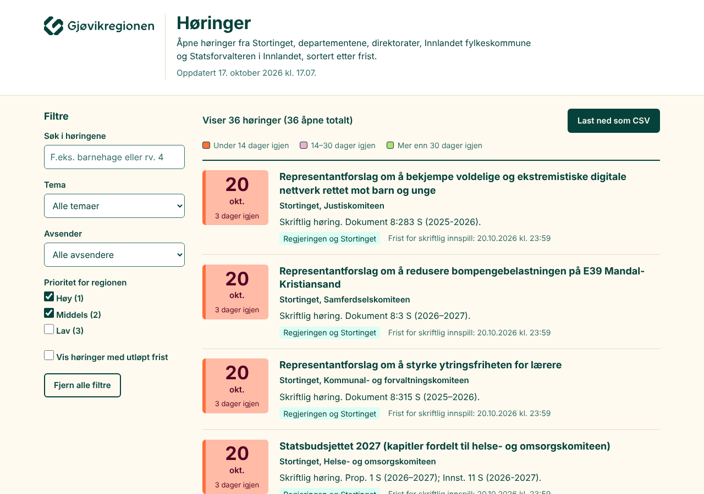
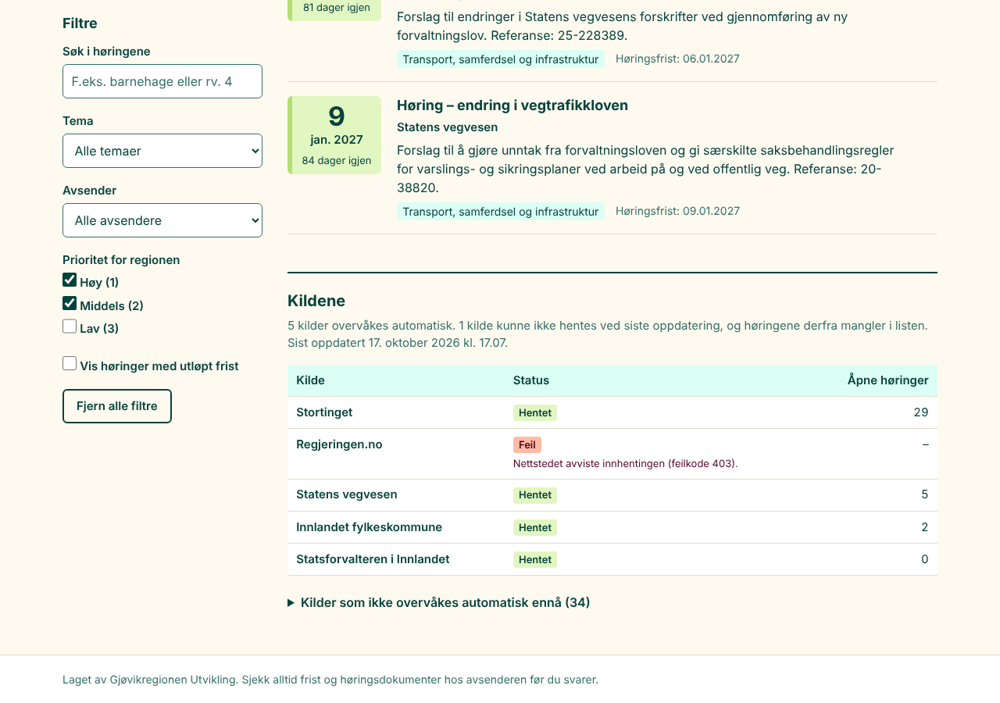
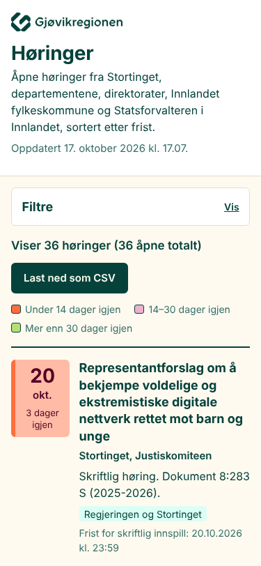
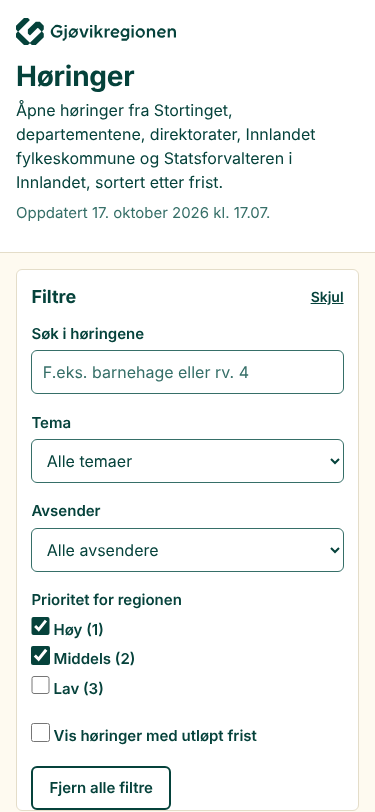

# Sprint 2 – Nettsiden

Rapportdato: 17. oktober 2026

## Sammendrag
Nettsiden er bygget som en statisk side uten eksterne avhengigheter, med Gjøvikregionens logo
og farger. Den viser høringene sortert på frist, med fargekoding, filtre, fritekstsøk,
statusoversikt per kilde og CSV-eksport, og filtrene lagres i adressen. 111 tester består,
blant dem 29 som kjører siden i Chromium, og axe-core finner ingen brudd på WCAG 2.1 AA på
mobil eller PC. Alle fem akseptansekriteriene er oppfylt. Sprinten anbefales godkjent.

## Hva som er bygget

| Fil | Innhold |
|---|---|
| `index.html` | Siden: topp med logo og oppdateringstid, filtre, liste, statusoversikt, bunntekst. Hopp-lenke, landemerker og etiketter for skjermlesere |
| `side/stil.css` | Utseende etter designsystemet, responsivt fra 320 px, utskriftsvennlig |
| `side/app.js` | Leser JSON-filene, regner dager igjen i norsk tid, filtrerer, sorterer, tegner listen og statusen, lager CSV. Ren JavaScript |
| `side/logo.svg`, `side/ikon.svg` | Logoen fra designsystemet og symbolet som fane-ikon |
| `data/horinger.json`, `data/status.json` | Resultatet fra testkjøringen 17.10.2026 kl. 17.07 (36 åpne høringer) |
| `sources.yaml`, `horinger/modell.py`, `horinger/kilder/base.py` | Nytt felt `niva` (Stortinget, Regjeringen, Direktorater og etater, Fylkeskommunen, Statsforvalteren) for filteret «Avsender» |
| `tests/test_nettside.py` | 29 tester av siden i Chromium, med egne testdata og fast dato |
| `tests/test_kjor.py` | 2 nye tester for `niva` |
| `.github/workflows/testkjoring.yml` | Installerer Chromium og axe-core, og lagrer testloggen på grenen `testkjoring` |
| `README.md`, `requirements.txt`, `.gitignore` | Dokumentasjon av siden og testene, Playwright 1.56.0 |
| `docs/sprinter/bilder/` | Skjermbilder |

**Valg underveis:**
- Kolonnen i statusoversikten viser **åpne høringer** per kilde, ikke antall hentet. Antall
  hentet var misvisende (Statens vegvesen: 448 hentet, 5 åpne).
- Feilmeldinger fra innhentingen vises i klarspråk («Nettstedet avviste innhentingen (feilkode
  403).»), ikke som teknisk tekst.
- Filtrene kan foldes sammen på mobil, der de er lukket som standard. På PC står de alltid
  åpne.
- Filteret «Prioritet» har etikettene Høy (1), Middels (2) og Lav (3).

## Skjermbilder

PC (1280 px):



Statusoversikten på PC:



Mobil (375 px), med filtrene lukket og åpnet:

 

## Kvalitetssikring

| Punkt | Resultat | Bevis / kommentar |
|---|---|---|
| A. Tester | Bestått | `pytest -v`: **111 bestått, 0 feilet, 0 hoppet over**, lokalt og i Actions-kjøring 39044500256 (`pytest.log` på grenen `testkjoring`: «111 passed in 17.82s»). Nye tester: 29 for siden, 2 for `niva` |
| B. Kodekvalitet | Bestått | `ruff check .`: «All checks passed!». `ruff format --check .`: «38 files already formatted». JavaScript og CSS er ikke kontrollert med et eget verktøy (f.eks. ESLint), men gjennomgått manuelt (G) og dekket av testene |
| C. Ekte data | Bestått | Siden med data fra testkjøringen 17.10: JSON-filen har 36 høringer, og siden viser 36 med standardfiltre. Statusoversikten viser Stortinget 29, Statens vegvesen 5, Innlandet fk 2, Statsforvalteren 0 åpne, og regjeringen.no med feil. Ingen feil i nettleserkonsollen |
| D. Stikkprøver | Bestått | 5 høringer fra tre kilder sammenlignet felt for felt mellom JSON og siden (tabell under). Ingen avvik |
| E. Tegn og datoer | Bestått | Æ, ø og å riktig på siden og i CSV (test med «æ, ø og å; «sitat» og "anførsel"»). CSV har BOM og semikolon, slik at norsk Excel leser den riktig. Frister vises i norsk format («17. november 2026», kortform «17 / nov.»). Dager igjen regnes fra dagens dato i Europe/Oslo, testet ved 0, 13, 14, 30 og 31 dager. Oppdateringstid vises i norsk tid («17. oktober 2026 kl. 10.05») |
| F. Feilhåndtering | Bestått | Testet: manglende `horinger.json` gir en tydelig feilmelding og deaktivert CSV-knapp. Manglende `status.json` gir melding, mens listen vises. Feilet kilde vises med forklaring. Tomt filterresultat gir melding og knapp for å fjerne filtrene |
| G. Kodegjennomgang | Bestått | Hele diffen siden godkjent sprint 1 er lest (22 filer, +2 108/−5, hvorav 1 355 uten data og bilder). Funnet og rettet: (1) vannrett rulling på mobil fordi listen ikke kunne krympe, (2) misvisende antall i statusoversikten, (3) teknisk feiltekst, (4) radoverskrifter i tabellen fikk samme bakgrunn som kolonneoverskriftene, (5) filtrene kunne foldes sammen ved et uhell på PC, (6) lenker i dataene ble ikke kontrollert, så en «javascript:»-adresse kunne blitt en klikkbar lenke. Nå blir bare http(s) lenker. All tekst settes med `textContent`, ikke som HTML |
| H. Høflighet | Bestått | Siden henter ingenting fra kildene eller andre nettsteder. Testen `test_ingen_eksterne_foresporsler` bekrefter at alle forespørsler går til egen server. Ingen sporing, ingen skrifter eller skript fra andre |
| I. Dokumentasjon | Bestått | README: hvordan siden vises lokalt, filtre i adressen, datafilene og testoppsettet. `sources.yaml`: forklaring av `niva` |
| J. Akseptansekriterier | Bestått | 5 av 5 oppfylt (tabell under) |

Kontrast (WCAG 2.1 AA krever 4,5:1 for vanlig tekst):

| Tekst / bakgrunn | Forhold |
|---|---|
| Skogsgrønn `#05423b` / beige `#fefaf0` | 10,9:1 |
| Sekundær `#366f68` / beige | 5,55:1 |
| Burgunder `#540024` / oransje 100 `#ffbba5` (under 14 dager) | 9,2:1 |
| Skogsgrønn / rosa 300 `#f8cee1` (14–30 dager) | 8,06:1 |
| Skogsgrønn / grønn 100 `#e2f6c2` (over 30 dager) | 9,84:1 |
| Skogsgrønn / turkis 300 `#dbfff5` (tema, tabellhode) | 10,62:1 |

Fargene står aldri alene: hver frist har også tekst («13 dager igjen»).

axe-core 4.10.2 mot siden med ekte data, regler for WCAG 2.0/2.1 A og AA pluss beste praksis:

```
375 px:  brudd: []  bestått: 52  ufullstendig: []
1280 px: brudd: []  bestått: 52  ufullstendig: []
```

I tillegg er tastaturnavigering testet: Tab gir hopp-lenken først, og Enter flytter fokus til
listen. Alle kontroller har synlig fokusmarkering.

## Stikkprøver
Det siden viser, sammenlignet med `data/horinger.json` (dagens dato 17.10.2026):

| Kilde | Høring | Felt kontrollert | Avvik | Lenke |
|---|---|---|---|---|
| Stortinget | Representantforslag om å bekjempe voldelige og ekstremistiske digitale nettverk … | tittel, instans, frist 20. oktober 2026, 3 dager igjen, lenke | Ingen | https://www.stortinget.no/no/Hva-skjer-pa-Stortinget/Horing/horing/?h=10005914 |
| Stortinget | Representantforslag om å redusere bompengebelastningen på E39 … | tittel, instans, frist, 3 dager igjen, lenke | Ingen | https://www.stortinget.no/no/Hva-skjer-pa-Stortinget/Horing/horing/?h=10005983 |
| Statens vegvesen | Høring om hest i trafikken | tittel, instans, frist 7. desember 2026, 51 dager igjen, lenke | Ingen | https://www.vegvesen.no/fag/publikasjoner/hoeringer/horing-om-hest-i-trafikken---forslag-til-endringer-i-trafikkregler-og-forskrift-om-bruk-av-kjoretoy/ |
| Statens vegvesen | Høring om personlige kjennemerker | tittel, instans, frist 15. desember 2026, 59 dager igjen, lenke | Ingen | https://www.vegvesen.no/fag/publikasjoner/hoeringer/horing-om-personlige-kjennemerker-26-132234-8/ |
| Innlandet fk | Planprogram: Regional plan for nettinfrastrukturen for energi | tittel, instans, frist 11. november 2026, 25 dager igjen, lenke | Ingen | https://innlandetfylke.no/politikk/horinger/planprogram-pa-horing-regional-plan-for-nettinfrastrukturen-for-energi.81920.aspx |

Høringsparter kontrolleres ikke, fordi de hentes i sprint 6.

## Akseptansekriterier

| Kriterium | Oppfylt | Bevis |
|---|---|---|
| `index.html` viser høringene fra sprint 1 med sortering, fargekoding, filtre, fritekstsøk og CSV-eksport | Ja | Testene `test_sortert_pa_frist…`, `test_fargeklasse_og_tekst` (6 tilfeller), `test_kategori`, `test_niva`, `test_prioritet_3`, `test_utlopte_kan_vises`, `test_fritekst…`, `test_csv_eksport` |
| Siden fungerer i mobil visning (375 px) og på PC, verifisert med skjermbilder | Ja | Skjermbildene over. `test_mobil_uten_vannrett_rulling` bekrefter at siden ikke er bredere enn 375 px og at filtrene virker på mobil |
| Tilgjengelighet er sjekket med et automatisk verktøy uten alvorlige funn | Ja | axe-core 4.10.2 via Playwright, 0 brudd på 375 og 1280 px (`test_tilgjengelighet_axe`, og kjøringen over med ekte data) |
| Statusoversikten per kilde vises | Ja | `test_statusoversikt`, skjermbilde av kildene |
| Siden fungerer lokalt uten eksterne avhengigheter utover det som er dokumentert | Ja | `test_ingen_eksterne_foresporsler`. Eneste krav er en enkel webserver, dokumentert i README |

## Kjente feil og begrensninger
1. **Filteret «Prioritet» har ingen synlig effekt i dag**, fordi alle de fem aktive kildene har
   prioritet 1. Det blir nyttig når direktoratene kommer inn i sprint 4 og 5.
2. **Regjeringen.no mangler** i dataene (se sprint 1). Statusoversikten viser dette tydelig.
3. **Skriften Satoshi er ikke med.** Siden bruker systemets skrift og Satoshi bare der den er
   installert.
4. **Designsystemet ligger under `/test/`** og kan endres. Fargene er samlet øverst i
   `side/stil.css`.
5. **Dager igjen regnes når siden lastes.** Står siden åpen over midnatt, oppdateres tallene
   først når den lastes på nytt.
6. **Siden kan ikke åpnes ved å dobbeltklikke på `index.html`**, fordi nettleseren ikke lar en
   lokal fil lese JSON. På GitHub Pages (sprint 3) er dette ikke noe problem.
7. **JavaScript er ikke kontrollert med en egen kodeanalyse** (f.eks. ESLint), bare med tester
   og manuell gjennomgang.

## Forslag til senere sprinter
- **Sprint 3:** Merket «Ny» og arkivet med utløpte høringer. Bryteren for utløpte høringer er
  allerede på plass og vil vise dem når arkivet finnes.
- **Sprint 3:** Når den ukentlige kjøringen skriver `data/`, bør siden vise en tydelig advarsel
  hvis dataene er eldre enn ti dager, slik at det synes hvis kjøringen har stoppet.
- **Sprint 6 og 7:** Filtrene for høringsparter og postlista legges inn i filterfeltet.

## Hva Svein bør sjekke selv
1. Se skjermbildene over, eller i repoet:
   https://github.com/shkorshavn/horingsoversikt-gru/tree/main/docs/sprinter/bilder
2. Vurder uttrykket: farger, logo, rekkefølgen på informasjonen i hver høring, og ordene som
   brukes («Tema», «Avsender», «Prioritet for regionen»).
3. Vurder om du savner noe i listen eller i CSV-filen (kolonnene er Frist, Dager igjen,
   Høringsinstans, Tittel, Tema, Avsender, Prioritet, Frist slik kilden skriver den, Lenke).
4. Godkjenn med «Sprint 2: JA <dato>» i chatten, eller be om endringer.
